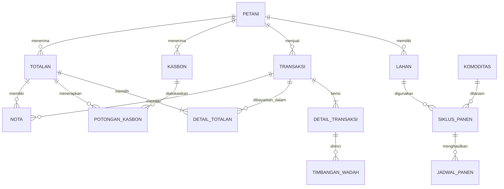

# Blueprint Capstone - Tani Jaya
## Dukungan Perangkat dan Responsive UI

Tani Jaya adalah aplikasi web responsive.

Prioritas penggunaan:
1. Smartphone Android
2. Desktop/laptop
3. Tablet

Desain menggunakan pendekatan mobile-first.

Setiap fitur utama harus dapat digunakan secara penuh pada mobile dan desktop.
Tidak boleh ada fungsi bisnis penting yang hanya tersedia pada salah satu ukuran layar.

Reference viewport untuk desain:
- Mobile: 390px
- Desktop: 1440px

Pola navigasi:
- Mobile: bottom navigation / compact navigation
- Desktop: sidebar navigation

Layout boleh berbeda antar perangkat selama alur bisnis dan data tetap konsisten.

**Status:** Final planning v1.0  
**Platform:** Responsive web application  
**Bahasa:** Indonesia  
**Target utama:** HP Android, tetap nyaman di laptop

## Arsitektur produk dan referensi modul

Tani Jaya memiliki dua domain transaksi:

- **Pembelian:** Tani Jaya membeli hasil panen dari Petani Mitra atau Penjual
  Umum.
- **Penjualan:** Tani Jaya menjual stok hasil pembelian kepada pembeli.

Alur tingkat produk:

```text
Petani / Penjual → Pembelian → Stok → Penjualan → Pembayaran / Piutang
```

Aturan bisnis Penjualan P0 berada di
[`docs/PRD-PENJUALAN.md`](./PRD-PENJUALAN.md) dan tidak diduplikasi di dokumen
master ini. Aturan Pembelian yang telah disetujui dalam dokumen ini tetap
terkunci dan tidak boleh diubah tanpa instruksi eksplisit.

## 1. Tujuan produk

Tani Jaya membantu satu Admin usaha pengepul sayuran untuk memantau jadwal panen,
membeli hasil panen, mengelola stok, menjual stok kepada pembeli, mencatat
kasbon dan totalan, membuat nota digital, menyimpan riwayat, serta melihat
laporan bulanan.

## 2. Pengguna

Hanya ada satu peran: **Admin**. Sistem menggunakan satu akun Admin dengan login email dan password.

## 3. Scope capstone

### P0 - wajib

1. Login dan logout Admin.
2. Dashboard operasional: panen hari ini/besok, Pembelian, Penjualan, stok,
   dan piutang pembeli dari data transaksi aktif.
3. Data petani mitra, lahan, dan komoditas.
4. Siklus panen, jadwal, penundaan, perubahan metode penerimaan, dan pengakhiran siklus.
5. Transaksi petani mitra dan penjual umum.
6. Timbang total langsung, per karung, dan per peti.
7. Kasbon, saldo hasil panen, totalan, dan pembayaran tunai.
8. Nota digital yang dapat dibuka serta dicetak/diunduh.
9. Riwayat dan pencarian transaksi.
10. Laporan bulanan di sistem.
11. Stok hasil pembelian dan transaksi Penjualan P0, termasuk pembayaran tunai
    serta piutang, sesuai `docs/PRD-PENJUALAN.md`.

### P1 - jika waktu cukup

- Tombol buka WhatsApp dengan pesan siap untuk mengirim nota.
- Cetak laporan bulanan.
- Grafik sederhana, ekspor PDF, PWA, dan notifikasi.

### Tidak termasuk

QR code dan pemindaian QR, akun petani, multi-role, AI/ML, prediksi harga, Google Maps/GPS, aplikasi native, pembayaran otomatis, dan WhatsApp API.

Penjualan P0 juga tidak mencakup profil pembeli permanen, transfer bank atau
e-wallet, retur, nomor resi atau integrasi ekspedisi, WhatsApp API, dashboard
keuntungan/margin, akun pembeli, maupun pembayaran otomatis. Rincian batasnya
berada di `docs/PRD-PENJUALAN.md`.

## 4. Aturan bisnis

### Batas domain Pembelian dan Penjualan

Seluruh aturan Pembelian di bagian ini—Petani, Lahan, Siklus Panen, Jadwal
Panen, perhitungan transaksi pembelian, Totalan, Kasbon, metode timbang, dan
aturan pembayaran pembelian—adalah aturan yang sudah disetujui dan tetap
berlaku tanpa perubahan.

Penjualan dapat memakai data stok yang berasal dari Pembelian, tetapi tidak
boleh mengubah alur Pembelian yang telah disetujui secara tidak perlu. Detail
stok, Penjualan, pengiriman, pembayaran, piutang, nota, pembatalan, dan laporan
Penjualan hanya mengikuti `docs/PRD-PENJUALAN.md`.

### Petani, lahan, dan komoditas

- Petani mitra menyimpan nama, nomor WhatsApp, patokan/deskripsi kebun, catatan, dan status aktif/nonaktif.
- Lokasi kebun tidak menggunakan alamat jalan, Google Maps, atau GPS.
- Petani nonaktif tidak dihapus karena riwayat dan sisa kasbonnya harus tetap dapat dilihat.
- Penjual umum tidak disimpan sebagai profil permanen; nama diisi pada setiap transaksi.
- Satu petani dapat memiliki banyak lahan.
- Satu lahan dapat memiliki beberapa siklus aktif hanya bila komoditasnya berbeda.
- Komoditas hanya menyimpan nama. Semua berat menggunakan kg dan seluruh harga dicatat per kg.

### Siklus dan jadwal panen

- Admin memasukkan interval panen per siklus karena mengikuti kesepakatan dengan petani.
- Siklus dimulai saat panen pertama benar-benar terjadi.
- Sistem membuat jadwal berdasarkan tanggal panen pertama, interval hari, dan estimasi jumlah panen.
- Jika petani mengonfirmasi tanggal panen baru, Admin memindahkan jadwal tersebut dan semua jadwal berikutnya ikut bergeser sesuai interval.
- Metode penerimaan default diatur pada siklus: `diambil` atau `diantar`.
- Admin dapat mengubah metode hanya untuk satu jadwal atau untuk jadwal ini dan seterusnya.
- Admin dapat mengakhiri siklus sebelum estimasi panen selesai; jadwal mendatang tidak lagi muncul, tetapi riwayat tetap ada.

### Transaksi dan penimbangan

- Satu transaksi berasal dari satu petani mitra atau satu penjual umum.
- Satu transaksi dapat berisi lebih dari satu komoditas.
- Setiap item Pembelian wajib menyimpan grade `SP`, `TG`, atau `BR`; grade tidak
  boleh diasumsikan atau diisi dengan nilai default diam-diam.
- Admin memilih metode timbang pada setiap komoditas: total langsung, per karung, atau per peti.
- Berat tiap karung/peti harus disimpan dan dapat dilihat kembali; semua berat adalah kilogram bulat.
- Potongan berat dicatat per komoditas dalam kg.
- Rumus: `berat bersih = berat kotor - potongan`; `subtotal = berat bersih x harga per kg`; `total transaksi = jumlah seluruh subtotal`.
- Penjual umum selalu langsung dibayar. Petani mitra dapat langsung dibayar atau ditandai belum dibayar untuk totalan.

### Stok hasil Pembelian

- Stok fisik adalah tampilan turunan dari Pembelian dan riwayat alokasi
  Penjualan; tidak ada input stok manual.
- Identitas stok mengikuti komoditas, grade, sumber penjual, metode timbang,
  dan berat fisik masuk. Potongan Pembelian tidak mengurangi stok fisik.
- Setelah sumber Pembelian memiliki riwayat alokasi Penjualan yang masih
  tersimpan, identitas dan berat sumbernya tidak boleh diubah secara biasa
  karena harus menjaga keterlacakan riwayat.

### Kasbon dan totalan

- Kasbon hanya untuk petani mitra; setiap kasbon menyimpan tanggal, nominal uang, dan deskripsi.
- Totalan memilih satu atau beberapa transaksi belum dibayar milik satu petani.
- Pembayaran hanya tunai.
- Kasbon dapat dipotong sebagai nominal umum atau dialokasikan ke kasbon tertentu, misalnya utang plastik.
- Total potongan kasbon tidak boleh melebihi total hasil panen yang dipilih.
- Jika kasbon lebih besar, petani menerima Rp0 dan sisa kasbon dibawa ke totalan berikutnya.

### Perubahan data dan nota

- Transaksi boleh diedit.
- Transaksi yang telah totalan atau dibayar memerlukan konfirmasi khusus sebelum diedit atau dihapus.
- Penghapusan transaksi terkait menghitung ulang totalan dan menerbitkan versi nota terbaru.
- Nota memiliki nomor unik, memuat rincian transaksi/pembayaran, serta dapat dibuka dan dicetak/diunduh.
- Foto nota kertas tidak disimpan.

## 5. User flow utama

### Petani dan siklus

`Tambah Petani -> Tambah Lahan -> Buat Siklus -> Isi komoditas, tanggal panen pertama, interval, estimasi, metode -> Sistem membuat jadwal`

### Transaksi petani mitra

`Pilih jadwal atau transaksi manual -> Tambah komoditas -> Pilih metode timbang -> Isi berat, potongan, harga/kg -> Sistem menghitung total -> Dibayar langsung atau belum dibayar -> Simpan -> Nota`

### Transaksi penjual umum

`Pilih Penjual Umum -> Isi nama -> Tambah komoditas dan timbang -> Isi harga/kg -> Simpan -> Status langsung dibayar -> Nota`

### Totalan

`Pilih Petani -> Pilih transaksi belum dibayar -> Sistem menghitung total -> Pilih potongan kasbon umum/per kasbon -> Simpan pembayaran tunai -> Transaksi menjadi sudah dibayar -> Nota totalan`

## 6. Daftar halaman

| Halaman | Fungsi utama |
|---|---|
| Login | Masuk dan logout satu Admin |
| Dashboard | Ringkasan Panen, Pembelian, Penjualan, stok, dan piutang pembeli |
| Stok | Ketersediaan stok hasil Pembelian untuk Penjualan |
| Transaksi | Memuat tab Pembelian dan Penjualan; tab default adalah Pembelian |
| Petani | Daftar, tambah, ubah, nonaktifkan, detail petani |
| Detail Petani | Lahan, siklus, transaksi, kasbon, saldo, dan totalan |
| Komoditas | Master nama komoditas |
| Siklus dan Jadwal | Buat, lihat, tunda, ubah metode, akhiri siklus |
| Transaksi Baru | Sumber transaksi, komoditas, timbang, potongan, harga, pembayaran |
| Riwayat Transaksi | Cari nama, tanggal, komoditas, ID, status pembayaran |
| Kasbon | Tambah kasbon serta lihat nominal dan sisa |
| Totalan | Pilih transaksi dan potong kasbon |
| Nota transaksi | Buka, cetak, dan unduh nota dari Detail Pembelian atau Detail Penjualan; bukan modul navigasi utama |
| Laporan Bulanan | Jumlah transaksi, total berat, total nilai, daftar totalan |

Target navigasi mobile: `Dashboard - Jadwal - Transaksi - Stok - Lainnya`.

Halaman **Transaksi** memuat tab `[ Pembelian ] [ Penjualan ]`. Tab default
adalah Pembelian. **Stok** menjadi modul navigasi utama. Halaman lanjutan
seperti form transaksi, nota, dan pembayaran tidak menjadi menu navigasi utama;
nota diakses secara kontekstual dari Detail Pembelian atau Detail Penjualan.

## 7. Wireframe ringkas

### Dashboard

Header ringkas, aksi Pembelian Baru, kartu ringkasan operasional untuk
Pembelian, Penjualan, stok, dan piutang, lalu selector aktivitas Panen,
Pembelian, atau Penjualan terbaru.

### Transaksi baru

Pilih sumber -> pilih petani atau isi nama penjual -> tambah komoditas -> timbang -> potongan -> harga/kg -> ringkasan total -> pilih status bayar -> simpan.

Setiap komoditas tampil sebagai kartu. Pada layar kecil, ringkasan total dan tombol simpan tetap berada di bawah layar.

### Jadwal panen

Filter Hari Ini, Besok, Minggu Ini, Semua. Setiap kartu jadwal berisi nama petani, komoditas, lahan, panen ke-, tanggal, metode, dan aksi Mulai Transaksi/Tunda/Ubah Metode.

### Totalan

Pilih petani, centang transaksi belum dibayar, lihat total hasil panen, buka panel potongan kasbon, lihat tunai diterima, lalu simpan totalan.

## 8. ERD konseptual



## 9. Struktur database logis

Gunakan UUID untuk ID, `BIGINT` untuk Rupiah, dan `INTEGER` untuk berat kg. Setiap tabel memiliki `created_at` dan `updated_at`.

| Tabel | Kolom inti |
|---|---|
| `petani` | nama, whatsapp, patokan_kebun, catatan, status |
| `lahan` | petani_id, nama_lahan, patokan_lokasi, catatan |
| `komoditas` | nama |
| `siklus_panen` | lahan_id, komoditas_id, tanggal_panen_pertama, interval_hari, estimasi_panen, metode_default, status |
| `jadwal_panen` | siklus_id, nomor_panen, tanggal_rencana, metode_penerimaan, status |
| `transaksi` | petani_id nullable, nama_penjual_umum nullable, tanggal, sumber, status_pembayaran, total_nilai |
| `detail_transaksi` | transaksi_id, komoditas_id, metode_timbang, berat_kotor_kg, potongan_kg, berat_bersih_kg, harga_per_kg, subtotal |
| `timbangan_wadah` | detail_transaksi_id, nomor_wadah, berat_kg |
| `kasbon` | petani_id, tanggal, nominal_awal, sisa_nominal, deskripsi |
| `totalan` | petani_id, tanggal, total_hasil_panen, potongan_kasbon, total_diterima |
| `detail_totalan` | totalan_id, transaksi_id, nilai_transaksi |
| `potongan_kasbon` | totalan_id, kasbon_id nullable, tipe_potongan umum/per_kasbon, nominal_potong |
| `nota` | nomor_nota, jenis, transaksi_id nullable, totalan_id nullable, versi |

Aturan validasi: potongan tidak boleh melebihi berat kotor; berat bersih tidak boleh negatif; transaksi hanya dapat masuk satu totalan; total potongan kasbon tidak boleh melebihi totalan; kombinasi lahan dan komoditas hanya boleh memiliki satu siklus aktif.

## 10. Stack teknis

- Next.js + TypeScript
- Tailwind CSS + shadcn/ui
- Supabase: PostgreSQL dan autentikasi satu Admin
- Vercel untuk deployment
- React Hook Form + Zod untuk form/validasi
- Motion for React untuk animasi

### Aturan animasi

- Hanya untuk transisi halaman ringan, kartu, modal/bottom sheet, form, dan feedback sukses/gagal.
- Gunakan `opacity` dan `transform`, durasi 150-250 ms.
- Hindari animasi terus-menerus/parallax dan dukung `prefers-reduced-motion`.

## 11. Urutan pembangunan dengan Codex

1. Buat fondasi frontend dengan dummy data: dashboard, navigasi desktop/mobile, dan animasi ringan.
2. Sambungkan Supabase, login Admin, dan data master petani/lahan/komoditas.
3. Buat siklus, generator jadwal, penundaan, perubahan metode, dan pengakhiran siklus.
4. Buat transaksi multi-komoditas dan tiga metode timbang.
5. Tambahkan kasbon, saldo, totalan, dan pembayaran tunai.
6. Tambahkan nota, riwayat/pencarian, dan laporan bulanan.
7. Rancang dan implementasikan Stok + Penjualan sesuai
   `docs/PRD-PENJUALAN.md` tanpa mengubah Pembelian yang telah disetujui.
8. Isi dummy data realistis dalam jumlah kecil, lalu uji demo.

## 12. User stories P0

- Admin dapat login, mengelola petani/lahan/komoditas, dan melihat dashboard.
- Admin dapat membuat, menunda, mengubah, dan mengakhiri siklus/jadwal panen.
- Admin dapat mencatat transaksi petani mitra atau penjual umum dengan beberapa komoditas dan rincian timbang.
- Admin dapat mencatat kasbon, membuat totalan, serta menyimpan pembayaran tunai.
- Admin dapat membuka/cetak nota, mencari transaksi, dan melihat laporan bulanan.
- Admin dapat melihat stok hasil Pembelian, membuat Penjualan, serta mencatat
  pembayaran dan piutang sesuai `docs/PRD-PENJUALAN.md`.

## 13. Prompt awal untuk Codex

```text
Buat aplikasi Next.js + TypeScript bernama Tani Jaya menggunakan Tailwind CSS,
shadcn/ui, dan Motion for React. Buat frontend mobile-first berbahasa Indonesia
dengan dummy data kecil: Dashboard, sidebar desktop, bottom navigation mobile,
kartu Panen Hari Ini/Panen Besok/Transaksi Hari Ini, daftar jadwal panen, daftar
transaksi terbaru, dan tombol + Transaksi Baru. Jangan buat database, Supabase,
login, QR code, atau fitur transaksi nyata pada tahap pertama. Pastikan proyek
dapat dijalankan tanpa error.
```
