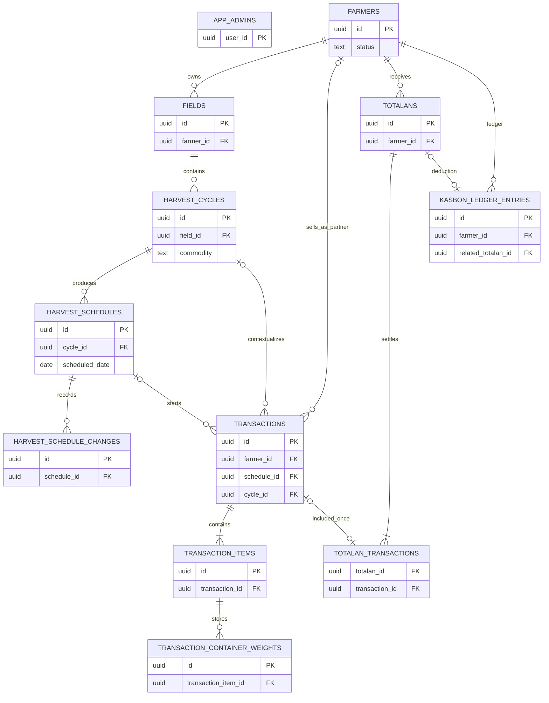
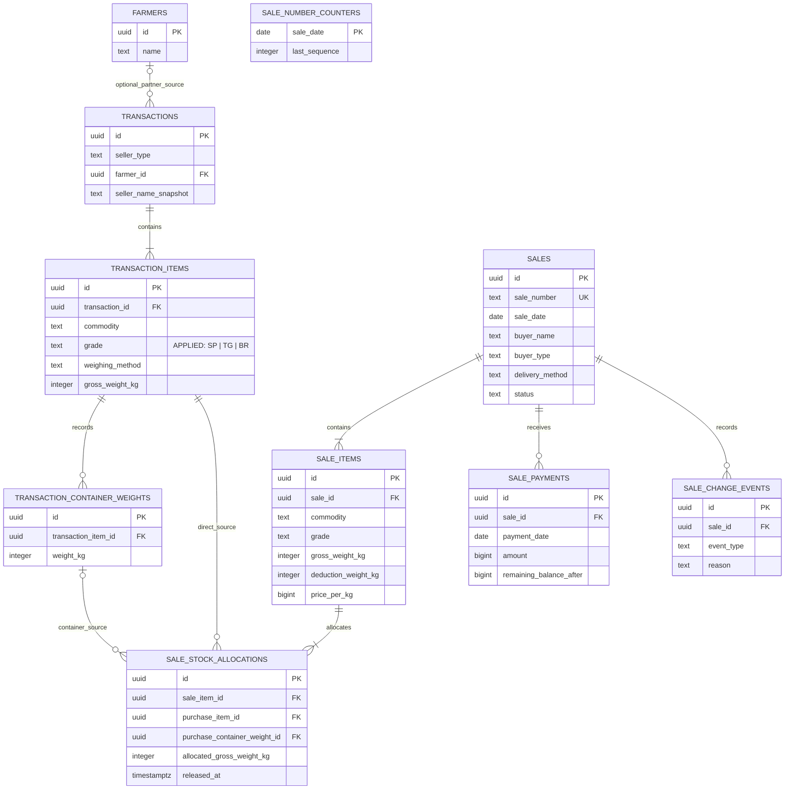

# Database foundation — Tani Jaya

This document describes the Supabase/PostgreSQL foundation and its current
application integration. Petani, Lahan, Siklus Panen, and Jadwal Panen use the
authenticated Supabase client as their source of truth; their UI maps typed
database rows into the existing camelCase domain models. Other application
modules continue to use their current local mock providers until their own
integration phase.

> **Sales + Stock status:** **APPLIED** through
> `20260921084125_sales_stock_domain.sql`. The applied design follows
> `docs/PRD-PENJUALAN.md`; existing Pembelian remains the source of stock.

## Entity list

- `app_admins`: minimal allowlist for the single authenticated Admin.
- `farmers`: active/inactive partner farmers; inactive rows are retained.
- `fields`: a farmer's named field and location reference.
- `harvest_cycles`: commodity-specific cycles owned by a field.
- `harvest_schedules`: effective dates and receiving methods for a cycle.
- `harvest_schedule_changes`: append-only schedule/date or receiving-method history.
- `transactions`, `transaction_items`, `transaction_container_weights`: purchases,
  per-commodity calculations, and each sack/crate weight.
- `totalans`, `totalan_transactions`: finalized settlement and its selected unpaid
  partner-farmer transactions.
- `kasbon_ledger_entries`: append-only advances and deductions.

Sales tables now applied: `sales`, `sale_items`, `sale_stock_allocations`,
`sale_payments`, `sale_change_events`, and `sale_number_counters`.

`Nota` is intentionally not a table. It remains derived from an immutable source
record's business number and payment data, consistent with the existing mock
implementation. A future immutable document/PDF snapshot requirement is the
threshold for adding a dedicated receipt table.

## Current applied ERD



## APPLIED: Sales + Stock ERD

This adds a Sales domain beside the applied Pembelian domain. It deliberately
does not add a customer table or a commodity master. A Sale holds its buyer
snapshot, and each `sale_items.commodity` is a historical snapshot validated
against its allocated purchase source.



`purchase_container_weight_id` is nullable only for a direct-weight allocation.
For a sack/crate allocation it points to the existing container row; its
`purchase_item_id` must be the item that owns that container.

## Applied design principles

### Stock is physical, derived, and internally traceable

- Any valid saved Pembelian item with available physical stock is eligible for
  Sales, whether its parent `transactions.seller_type` is `partner_farmer` or
  `general_seller`.
- Internal traceability always follows the existing purchase transaction. A
  partner-farmer source has `farmer_id` when available plus
  `seller_name_snapshot`; a general-seller source has no `farmer_id` and uses
  `seller_name_snapshot` as its source identity. This is a **source seller**,
  not necessarily a farmer.
- Physical stock-in is `transaction_items.gross_weight_kg`, never its purchase
  `net_weight_kg`. Purchase deduction therefore affects only the purchase value.
- Physical stock-out is `sale_items.gross_weight_kg`, never sale net weight.
  Sale deduction affects only the buyer invoice value.
- No mutable `current_stock` field is proposed. Availability is derived from
  purchase gross weight minus active allocation rows. This avoids a stock total
  that can drift from history.
- The allocation layer is internal. Buyer Nota data is projected from `sales`,
  `sale_items`, and payment totals only; it must not select source sellers,
  purchase transactions, allocation rows, or expedition cost.

### Grade and commodity identity

`transaction_items.grade` is the canonical incoming-stock grade and must be one
of `SP`, `TG`, or `BR`. A sale item stores both `commodity` and `grade` as
historical snapshots, not a new commodity master. The future write operation
must validate that every active allocation has the same commodity and grade as
its sale item. This preserves readable historical Sales data while keeping the
existing purchase commodity representation unchanged.

### Lifecycle and payment state are separate

`sales.status` represents only lifecycle: `active` or `cancelled`. It is not a
mutable payment-status field. `sale_payment_states` derives paid amount,
remaining balance, and `paid`/`unpaid` from `sum(sale_payments.amount)` versus
`sales.total_amount`; it reports `cancelled` separately for a cancelled Sale.
This prevents a header status from becoming inconsistent with payment history.

`DP/Titip` and `Utang` describe only the initial payment choice. They are not
persisted as a later state: a DP has a first positive payment less than the
total, while Utang has no first payment.

## Applied schema specification

All identifiers are lowercase snake_case. UUID is used for identifiers, weights
are whole `integer` kilograms, and all Rupiah fields are `bigint`. `created_at`
and other audit events are `timestamptz`; business dates are `date`.

### Minimal Purchase-side additions required for Sales

The approved Pembelian workflow, formulas, weighing methods, and existing
container rows remain unchanged. The only required purchase-table addition is:

| Entity | Column | Type | Nullable | Default | FK | Constraints / meaning |
|---|---|---:|---|---|---|---|
| `transaction_items` (existing) | `grade` | `text` | no | none | — | `SP`, `TG`, or `BR`; one physical incoming stock grade per purchase item. A source seller bringing one commodity in different grades uses separate existing purchase-item rows. |

`transaction_container_weights` already gives each sack/crate an immutable
source ID and physical weight. No duplicated container-weight or stock-source
table is used. The linked database had no `transaction_items` rows when this
required `NOT NULL` field was applied, so no historical grade backfill or
default grade was needed. A future schema change must still never silently
infer a grade for existing rows.

### `sales` — Sale/Nota header (applied)

| Column | Type | Nullable | Default | FK | Constraints / business meaning |
|---|---:|---|---|---|---|
| `id` | `uuid` | no | generated UUID | — | Primary key. |
| `sale_number` | `text` | no | allocated by database operation | — | Unique, immutable Nota number in `PJ-YYYYMMDD-NNNN` format; never browser-generated. |
| `sale_date` | `date` | no | none | — | Business date and sequence-counter key. |
| `buyer_name` | `text` | no | none | — | Trimmed, non-empty snapshot; no customer profile. |
| `buyer_type` | `text` | no | none | — | `general_buyer`, `weigher_collector`, or `market` for pembeli umum, penimbang/pengepul, or pasar. |
| `delivery_method` | `text` | no | none | — | `buyer_pickup` or `expedition`. |
| `expedition_name` | `text` | yes | `null` | — | Required only for `expedition`; internal detail only. |
| `expedition_rate_per_kg` | `bigint` | yes | `null` | — | Non-negative; required only for `expedition`; internal detail only. |
| `expedition_cost` | `bigint` | no | derived/stored from gross weight × rate | — | Internal Tani Jaya expense. It is never added to `total_amount` or buyer receivable. It is `0` for buyer pickup. |
| `total_gross_weight_kg` | `integer` | no | `0` while draft is assembled | — | Sum of sale-item gross weights; final Sale must be positive. |
| `total_deduction_weight_kg` | `integer` | no | `0` | — | Sum of sale-item deductions. |
| `total_net_weight_kg` | `integer` | no | `0` | — | Sum of sale-item net weights. |
| `total_amount` | `bigint` | no | `0` | — | Sum of sale-item subtotals; buyer invoice total only. |
| `status` | `text` | no | `active` | — | `active` or `cancelled`; separate from payment state. |
| `cancellation_reason` | `text` | yes | `null` | — | Required, trimmed, non-empty when `status = 'cancelled'`. |
| `cancelled_at` | `timestamptz` | yes | `null` | — | Required exactly when cancelled. |
| `created_at` | `timestamptz` | no | `now()` | — | Audit time. |
| `updated_at` | `timestamptz` | no | `now()` | — | Maintained by the existing shared timestamp pattern. |

Header totals are persisted audited snapshots maintained from persisted
`sale_items` in the same atomic operation (or a trigger), never client supplied
independent calculations. Delivery checks require all expedition fields to be
present only for `expedition`, and absent/zero as applicable for `buyer_pickup`.

### `sale_items` — invoice lines (applied)

| Column | Type | Nullable | Default | FK | Constraints / business meaning |
|---|---:|---|---|---|---|
| `id` | `uuid` | no | generated UUID | — | Primary key. |
| `sale_id` | `uuid` | no | none | `sales.id` | Parent Sale. The normalized `(sale_id, commodity, grade)` identity is unique. |
| `commodity` | `text` | no | none | — | Trimmed, non-empty historical commodity snapshot; no new master. |
| `grade` | `text` | no | none | — | `SP`, `TG`, or `BR`; the same commodity at different grades is a different row. |
| `gross_weight_kg` | `integer` | no | none | — | Positive physical stock-out. |
| `deduction_weight_kg` | `integer` | no | `0` | — | Whole kg from 0 through gross weight. It does not reduce stock a second time. |
| `net_weight_kg` | `integer` | no | generated/stored | — | `gross_weight_kg - deduction_weight_kg`. |
| `price_per_kg` | `bigint` | no | none | — | Non-negative integer Rupiah. |
| `subtotal` | `bigint` | no | generated/stored | — | `net_weight_kg * price_per_kg`. |
| `created_at` | `timestamptz` | no | `now()` | — | Audit time. |
| `updated_at` | `timestamptz` | no | `now()` | — | Audit time for controlled corrections. |

The future operation validates that the active allocations for each line add up
exactly to `gross_weight_kg`; deductions and price cannot change that physical
allocation total.

Within one Sale, buyer-facing lines use a unique PostgreSQL expression index on
`(sale_id, lower(btrim(commodity)), grade)`. The stored `commodity` remains the
readable snapshot; `lower(btrim(commodity))` makes identity case- and
outer-whitespace-insensitive without introducing a commodity master or a
case-sensitive uniqueness bug. Thus Timun SP sourced from several sellers is
one Sale item with several allocations, while Timun TG remains a separate line.

### `sale_stock_allocations` — internal source consumption (applied)

| Column | Type | Nullable | Default | FK | Constraints / business meaning |
|---|---:|---|---|---|---|
| `id` | `uuid` | no | generated UUID | — | Primary key. |
| `sale_item_id` | `uuid` | no | none | `sale_items.id` | The buyer-facing line consuming the source. |
| `purchase_item_id` | `uuid` | no | none | `transaction_items.id` | Required source item for both allocation forms. |
| `purchase_container_weight_id` | `uuid` | yes | `null` | `transaction_container_weights.id` | Exact container source for sack/crate; `null` only for `direct_total`. |
| `allocated_gross_weight_kg` | `integer` | no | none | — | Positive physical kg allocated. It is partial kg for direct total; it equals the container's complete `weight_kg` for a sack/crate. |
| `released_at` | `timestamptz` | yes | `null` | — | A released allocation remains historical but no longer consumes stock. It is set for cancellation or allocation replacement, never deleted just to restore stock. |
| `release_reason` | `text` | yes | `null` | — | Required when released; `sale_corrected` or `sale_cancelled`. |
| `created_at` | `timestamptz` | no | `now()` | — | Audit time. |

The future database validation must enforce all of the following:

- the purchase transaction is a valid saved Purchase from either permitted
  seller type and the source item has physical stock available;
- source commodity and grade equal their `sale_items` snapshot;
- a direct allocation has a `direct_total` source item and no container ID;
- a container allocation has a `per_sack`/`per_crate` source item, matches the
  referenced container's parent item and type, and allocates exactly its full
  physical weight;
- each active container allocation is globally unique through a partial unique
  index on `purchase_container_weight_id where released_at is null`;
- for direct sources, active allocated kg never exceeds the source item's
  `gross_weight_kg`; and
- active allocations for the sale item equal its gross weight exactly.

The unique container index is the database-level protection against selling one
karung/peti twice. Aggregate direct-weight availability cannot be guaranteed by
a simple `CHECK`; the controlled transaction must lock source purchase-item rows
in ascending UUID order, calculate active allocation totals, then insert/update
the allocation inside that same short transaction.

### `sale_payments` — cash payment history (applied)

| Column | Type | Nullable | Default | FK | Constraints / business meaning |
|---|---:|---|---|---|---|
| `id` | `uuid` | no | generated UUID | — | Primary key. |
| `sale_id` | `uuid` | no | none | `sales.id` | Exactly one Sale/Nota per payment. |
| `payment_date` | `date` | no | none | — | Operational date of the cash payment. |
| `amount` | `bigint` | no | none | — | Positive integer Rupiah. No bank/e-wallet fields are proposed for P0. |
| `remaining_balance_after` | `bigint` | no | none | — | Non-negative balance snapshot after this payment, written by the atomic payment operation for audit/readability. |
| `created_at` | `timestamptz` | no | `now()` | — | Audit time. |

`created_at` is the immutable ledger/audit order. `payment_date` remains the
operational payment date, and `remaining_balance_after` is calculated when the
controlled atomic operation inserts the row. `sum(sale_payments.amount)` is the
source of truth for current paid amount and state; the balance snapshot is not a
mutable header balance. Ordinary direct editing, deletion, or reordering of
payment rows is not allowed. `recorded_by` is intentionally not proposed: this
is the existing single-Admin architecture and `created_at` plus the
authenticated operation already identify its administrative context without
extending the Auth schema.

### `sale_change_events` — required cancellation/correction reasons (applied)

| Column | Type | Nullable | Default | FK | Constraints / business meaning |
|---|---:|---|---|---|---|
| `id` | `uuid` | no | generated UUID | — | Primary key. |
| `sale_id` | `uuid` | no | none | `sales.id` | Sale being changed. |
| `event_type` | `text` | no | none | — | `corrected` or `cancelled`. |
| `reason` | `text` | no | none | — | Trimmed, non-empty reason required by the PRD. |
| `created_at` | `timestamptz` | no | `now()` | — | Audit time. |

The header keeps the current cancellation state for fast queries; this small
append-only relation preserves a reason for every correction as well as the
cancellation reason. It does not introduce a customer, stock, or profit
abstraction.

### `sale_number_counters` — concurrency-safe Nota sequencing (applied)

| Column | Type | Nullable | Default | FK | Constraints / business meaning |
|---|---:|---|---|---|---|
| `sale_date` | `date` | no | none | — | Primary key; one counter per business date. |
| `last_sequence` | `integer` | no | `0` | — | `0..9999`; incremented atomically. |
| `created_at` | `timestamptz` | no | `now()` | — | Audit time. |
| `updated_at` | `timestamptz` | no | `now()` | — | Audit time. |

The future create-Sale database operation must atomically upsert the row for
`sale_date`, increment and return `last_sequence`, then format
`PJ-YYYYMMDD-NNNN` and insert the uniquely constrained `sales.sale_number` in
the same transaction. A deleted no-payment sale does not decrement this counter,
so a Nota number is never reused. This avoids the race in `SELECT count(*) + 1`
and browser-side numbering.

### Derived read models (applied)

The following should be non-editable `security_invoker` views (or equivalent
read-only, server-side queries); neither is a manually maintained stock table.

| Read model | Source / output | Rule |
|---|---|---|
| `available_sale_direct_stock` | Eligible direct purchase item, commodity, grade, source seller identity, gross incoming kg, active allocated kg, remaining kg | `remaining = transaction_items.gross_weight_kg - sum(active direct allocations)`; rows with `remaining <= 0` are omitted. The source seller comes from the purchase transaction: optional farmer plus seller snapshot, or general-seller snapshot. |
| `available_sale_container_stock` | Eligible individual sack/crate with commodity, grade, source seller identity, container ID/type/weight | Only a container with no active allocation is available. A released allocation does not block it. |
| `sale_payment_states` | Sale total, total paid, remaining balance, effective payment state | `remaining = total_amount - sum(payments)`; reports `paid`, `unpaid`, or `cancelled` from the lifecycle plus payment totals. |

The stock views join allocations only when `released_at is null` and the parent
Sale is `active`, as a defensive read condition. A successful cancellation must
also set `released_at` atomically so the partial unique container index permits
the container to be sold again.

## Applied controlled atomic operations

Direct table writes cannot safely enforce all cross-row stock and payment rules.
The applied migration exposes narrow, Admin-authorized database operations
rather than accepting independent browser writes to sale headers, lines,
allocations, counters, and payments.

## Applied Purchase atomic operations

Migration `20260923044053_purchase_atomic_operations.sql` establishes the
database boundary for Pembelian.

### Purchase UI integration

Pembelian is now an active Supabase-backed UI integration. The Purchase provider
reads the persisted transaction graph (`transactions`, items, containers, and
required farmer/cycle/schedule relations) through typed adapters; it has no
fixture fallback. Create uses `create_purchase`, edit uses `update_purchase`,
and both reload the canonical graph after a successful RPC. Digital and thermal
Purchase Nota remain derived from that persisted graph rather than stored as
separate rows.

### Purchase number allocation

`purchase_number_counters` is internal infrastructure with one row per
`operational_date`. `private.create_purchase` derives that date from the
database clock in `Asia/Jakarta`, atomically increments the row with
`INSERT ... ON CONFLICT ... UPDATE ... RETURNING`, then creates an immutable
Purchase number:

```text
PB-YYYYMMDD-NNNN
```

For example, the first committed Purchase allocated on 23 September 2026 is
`PB-20260923-0001`. The counter is never decremented by a correction or any
future removal workflow, so committed numbers are never reused. The editable
`transactions.transaction_date` is intentionally separate from the number's
operational-date component.

### Controlled Purchase RPCs

Authenticated callers use only these public functions:

```text
public.create_purchase(p_payload jsonb)
  returns table (transaction_id uuid, transaction_number text)

public.update_purchase(p_transaction_id uuid, p_payload jsonb)
  returns table (transaction_id uuid, transaction_number text)
```

The payload holds the existing header fields (`transaction_date`, optional
`transaction_time`, `seller_type`, `farmer_id` or `seller_name_snapshot`,
optional cycle/schedule context, `payment_status`, and `notes`) plus a nonempty
`items` array. Each item holds `id` only when updating an existing row,
`commodity`, `grade`, `weighing_method`, `gross_weight_kg`,
`deduction_weight_kg`, `price_per_kg`, and `containers`. A container holds `id`
only when retaining an existing container, `sequence_number`, and `weight_kg`;
its database type is derived from the item's weighing method.

Both operations execute as one PostgreSQL transaction. Create validates the
Admin, header, items, counter allocation, header insert, all item inserts,
appropriate container inserts, and final persisted totals before returning.
Any failure rolls back the number allocation and every inserted row. The
existing item trigger remains the sole writer of audited transaction totals;
the RPC verifies those totals after persistence rather than accepting a client
total.

Validation requires a valid farmer for `partner_farmer`, a nonempty snapshot
and no farmer/cycle/schedule for `general_seller`, and `paid` status for a
general seller. Grade is exactly `SP`, `TG`, or `BR`; money and weight payload
values are JSON whole numbers; deductions are from zero through gross weight;
and price is non-negative. `direct_total` requires no container rows, while
`per_sack` and `per_crate` require positive individual containers whose sum is
exactly the item gross physical weight. Purchase net weight and value continue
to be derived separately from physical gross stock.

`update_purchase` locks the Purchase, its items, and its containers before
changing them. It rejects `PURCHASE_FINALIZED_TOTALAN` when the Purchase is in
a finalized Totalan. An item with retained `sale_stock_allocations` history
cannot be deleted or have its commodity, grade, weighing method, gross physical
weight, or container composition changed; seller identity is similarly locked
for a Purchase with any such history. Financial item fields can still be
changed when no finalized Totalan applies. Unused items and their containers
may be added, replaced, or removed atomically. `transaction_number` is never
updated or regenerated.

The private implementation functions are `SECURITY DEFINER` with an empty
explicit search path and call the existing `private.require_current_admin()`
authorization guard. Public wrappers are executable only by `authenticated`;
`anon` has no grants. The counter has RLS and no direct client grants. Direct
Purchase `INSERT`, `UPDATE`, and `DELETE` grants have been revoked from
`authenticated`, so RLS policies cannot be used to bypass the controlled
mutation rules; Admin read access remains governed by the existing model.

| Operation | Required atomic work |
|---|---|
| Create Sale | Authorize Admin; allocate number; lock all source purchase items and containers in stable UUID order; verify availability and source/grade match; insert Sale, lines, and allocations; calculate header totals/expedition cost; optionally insert one valid initial cash payment; commit. |
| Record payment | Lock the active Sale and its payment history; derive remaining balance; reject amount `<= 0` or above remaining; insert payment with balance snapshot; commit. |
| Correct Sale | Lock old and proposed sources in stable order; reject a corrected total below already received cash because refund automation is outside P0; release replaced allocations and insert replacements in one transaction; recompute the same Sale's item/header totals; append `corrected` reason; commit. This yields the final consumption, not old plus new consumption. |
| Cancel Sale | Lock the Sale; preserve Sale, items, allocations, and payments; set lifecycle cancellation fields; release its active allocations with reason; append event; commit. No refund is created. |
| Hard delete Sale | Lock the Sale; reject if any payment exists; then delete the header. Child Sale items and allocations may cascade only in this no-payment case, leaving no orphan allocations and automatically making stock available. |

The lock scope must stay short and contain no network calls. The purchase items
and containers must always be acquired in a consistent ID order to avoid
deadlocks when one Sale uses stock from multiple source sellers.

### Finalized P0 correction and reporting rules

- A Sale with payment history may be corrected only when its revised
  `total_amount >= sum(sale_payments.amount)`. A smaller total is rejected:
  refund/customer-credit handling is outside P0.
- Cancelled Sales remain visible and traceable in Sales history, but normal
  monthly totals filter to `sales.status = 'active'`. Cancelled records do not
  contribute to the valid-note count, physical gross stock-out, net sale weight,
  Sale value, cash received, or buyer receivable. They may be displayed
  separately.

### Purchase edit lock after Sales use

A Purchase source is historically used as soon as a retained
`sale_stock_allocations` row exists, including a row released by Sale
cancellation or correction. Its stock-relevant fields must then be locked from
ordinary Pembelian edits: commodity, grade, weighing method, gross physical
weight, individual sack/crate weights, and source seller/farmer identity where
changing it would invalidate traceability. Non-stock metadata such as notes may
continue to follow the existing Pembelian edit rules.

If a Purchase source has never appeared in a retained allocation, its
stock-relevant fields remain governed by the approved Pembelian rules. If a
permitted no-payment Sale is permanently deleted, its child allocation rows are
legitimately removed; that deleted Sale leaves no surviving Sales allocation
history to trigger this lock. P0 deliberately does not introduce a separate
Purchase stock-correction workflow.

## Applied indexes and uniqueness

Every foreign-key column below receives an index unless already covered by a
primary/unique key.

| Entity | Applied index / constraint | Reason |
|---|---|---|
| `transaction_items` | `grade` check; existing `transaction_id` index remains | Grade is the required minimal stock-source addition; source joins remain indexed. |
| `sales` | unique `sale_number`; `(sale_date desc)`; `(status, sale_date desc)` | Nota lookup, monthly reporting, and active/cancelled history. |
| `sales` | `lower(btrim(buyer_name)) text_pattern_ops` index | Buyer-name equality/prefix search without a customer master. Do not add trigram search until the search UX requires infix matching. |
| `sale_items` | `(sale_id)`; unique expression `(sale_id, lower(btrim(commodity)), grade)`; `(commodity, grade)` | Header join, one normalized commodity/grade line per Sale, and commodity/grade history filtering. |
| `sale_stock_allocations` | `(sale_item_id)`; `(purchase_item_id)` plus `(purchase_item_id) where released_at is null`; `(purchase_container_weight_id)` plus unique `(purchase_container_weight_id) where purchase_container_weight_id is not null and released_at is null` | Foreign-key safety, direct-stock aggregation, and one active sale per container. |
| `sale_payments` | `(sale_id, created_at, id)`; `(payment_date desc)` | Read immutable ledger order and report cash received by business date. |
| `sale_change_events` | `(sale_id, created_at desc)` | Ordered audit display. |
| `sale_number_counters` | primary key `(sale_date)` | Atomic per-date number allocation. |

The migration applies only these direct joins and documented query indexes.
Review common reporting/filter plans with `EXPLAIN ANALYZE` after representative
production data exists before adding further indexes.

## Applied foreign-key delete strategy

| Child → parent | Applied action | Why |
|---|---|---|
| `sales` items → `sales` | `CASCADE` | Only supports the permitted hard delete of a Sale with no payments. |
| allocations → `sale_items` | `CASCADE` | Removes child allocations with the no-payment hard delete and prevents orphans. Cancellation never deletes them; it releases them. |
| allocations → `transaction_items` | `RESTRICT` | Purchase-stock source traceability must not be destroyed. |
| allocations → `transaction_container_weights` | `RESTRICT` | An allocated container cannot be deleted or detached from history. |
| payments → `sales` | `RESTRICT` | A Sale with payment history cannot be hard deleted; payment history cannot disappear by cascade. |
| change events → `sales` | `CASCADE` | A no-payment Sale may be permanently deleted per PRD; its no-payment correction/cancellation metadata has no surviving parent. |
| existing `transaction_items` → `transactions` | keep `RESTRICT` | The approved purchase history remains intact. |
| existing containers → purchase items | keep `RESTRICT` | Container traceability remains intact. |

There is no `SET NULL` relationship in the applied Sales chain: every retained
financial or stock-traceability row requires its parent. The only cascades are
strictly bounded to the explicitly permitted no-payment hard-delete path.

## Applied RLS and access model

- RLS is enabled on every public Sales table, including technical counter
  data. Continue using the existing `app_admins` allowlist and
  `private.is_current_admin()` predicate, evaluated once in policies.
- `anon` receives no table grants, no policies, and no operational data access.
- An allowlisted authenticated Admin may read the Sales domain needed for the
  application. Views must use `security_invoker = true` so their underlying
  table RLS still applies.
- Direct `INSERT`/`UPDATE`/`DELETE` on the counter, allocations, payments, and
  change events are not broadly granted. In particular, payment rows are
  append-only and ordered by immutable `created_at`. The applied narrow
  creation, correction, cancellation, payment, and deletion operations perform
  their own Admin check and enforce the atomic rules above.
- Be conservative with deletion: no normal `DELETE` policy for
  `sale_payments`, allocation history, or change events. The only permitted
  permanent Sale deletion is a controlled operation that first proves payment
  history is empty. No service-role credential is required.

## Buyer Nota versus Admin detail

| Buyer Nota projection | Admin detail may additionally show |
|---|---|
| Tani Jaya identity; sale number/date; buyer name; commodity; grade; gross, deduction, and net kg; price/kg; subtotal; total; total paid; remaining balance; effective payment status; delivery method | Source seller/farmer where applicable; originating purchase item; individual container allocations; expedition name; expedition rate/kg; and expedition total cost. |

Buyer-facing projections must never include source seller/farmer, purchase transaction,
internal allocation, expedition rate, or expedition cost. No separate Nota
table is necessary for P0; the projection is derived from persisted Sale data.

## Validation walkthrough

| Case | Expected applied result |
|---|---|
| A — Partner Farmer Purchase: containers 32, 35, 31 kg; sell 32 + 31 | Two active allocation rows point to the exact 32 and 31 kg container IDs and trace to the partner farmer through the purchase transaction. Physical stock-out is 63 kg; the 35 kg container has no active allocation and remains available. |
| B — General Seller Purchase: direct 100 kg; sell 40 kg | One direct allocation points to the general seller's purchase item. The seller is internally identified by `seller_name_snapshot`; derived availability is `100 - 40 = 60 kg`. |
| C — Timun SP 100 kg: 40 kg Partner Farmer A + 60 kg General Seller B | One `sale_items` row has two internal allocation rows, each to its own purchase item. Buyer Nota shows only Timun SP 100 kg; Admin detail shows 40 kg from Partner Farmer A and 60 kg from General Seller B. |
| D — gross 100 kg, sale deduction 4 kg | The allocation and physical stock-out are 100 kg. `sale_items.net_weight_kg` is 96 kg and its subtotal uses 96 kg. |
| E — Rp1,000,000 with payments Rp300,000, Rp400,000, Rp300,000 | Three immutable payment rows retain balances Rp700,000, Rp300,000, Rp0. The derived state becomes `paid`. |
| F — paid Sale cancelled | The Sale, items, allocations, payments, and cancellation event remain. Allocations are released, so stock is available again; no refund row is created. |
| G — incorrect Sale with no payments hard deleted | The controlled delete allows it. Sale items and allocations cascade with their parent, no allocation is orphaned, and the source becomes available again. |

## Migration readiness record

There were no remaining unresolved Sales + Stock P0 decisions when the migration
was applied. The read-only linked-database check on 2026-09-21 returned
`transaction_items_count = 0`; `transaction_items.grade` was therefore applied
as required `NOT NULL` without historical classification or a default grade.

## Important data rules

- UUID is the database key. Human readable `transaction_number` and
  `totalan_number` are separate unique business identifiers.
- Operational dates use `date`; actual events/audit fields use `timestamptz`.
- Weight is `integer` whole kilograms. Rupiah is `bigint`; there is no float or
  decimal money field.
- `transaction_items.net_weight_kg` and `subtotal` are generated from source
  inputs. A trigger refreshes transaction totals from the persisted items.
- A general seller has no `farmer_id` and only a name snapshot. A partner farmer
  requires a `farmer_id`; the name snapshot protects historical receipts.
- `totalan_transactions.transaction_id` is unique, so a transaction cannot be
  in two totalans. Its effective state is exposed by
  `transaction_payment_states`: `paid`, `unpaid`, or `included_in_totalan`.
  This avoids a second conflicting base payment-status column.
- `totalans` have a gross amount, kasbon deduction and final amount check:
  `final = gross - deduction`; a deduction cannot exceed gross harvest value.
- Kasbon balance is a view over append-only ledger entries, never a separately
  editable balance. A totalan-linked deduction must equal the totalan's stored
  deduction and may not exceed the farmer's current ledger balance.
- Finalized totalans and ledger entries reject update/delete operations. All
  financial and historical FKs use `RESTRICT`, never broad `CASCADE`.

## Schedule rules

`created_at` is not a harvest or schedule starting date. Only
`first_harvest_at` records a real first harvest. The partial unique index permits
multiple active cycles on a field only when their normalized commodities differ.

`harvest_schedules.receiving_method` stores the effective method; the cycle value
is only the default used when generating a schedule. A schedule is not marked
“late” or “postponed”: late is derived from its date and operational date, while
the `harvest_schedule_changes` history records rescheduling or method changes.
Its `scope` preserves whether a change was made for one schedule or the current
and following schedules.

## Constraints and indexes

The migration contains:

- partial unique active-cycle index by `(field_id, lower(trim(commodity)))`;
- seller source, weights, deduction, generated subtotal/net, financial total,
  and totalan membership constraints;
- container-type trigger ensuring sacks/crates match their item's weighing mode;
- query indexes for dashboard dates, farmer histories, schedules, reporting,
  transaction items, totalans, and ledger histories;
- one shared `set_updated_at` trigger function for mutable records.

## RLS strategy

All operational and financial tables have RLS enabled. The single Admin is
allowlisted in `app_admins` using their `auth.users` UUID. Policies grant data
access only when `is_current_admin()` is true; `app_admins` itself remains
service-role provisioned. Before connecting the UI, create the intended Admin
auth user and insert only that user's ID into `app_admins` with a secure server
or Supabase dashboard workflow. Financial tables are never exposed to `anon`.

## Future integration boundary

## Phase 3 application integration

- **Stock is Supabase-derived and read only.** The application maps
  `available_sale_direct_stock` for direct-weight availability, then reads the
  persisted `transaction_container_weights` and active
  `sale_stock_allocations` for exact sack/crate identity and status. Incoming
  physical stock remains Purchase **gross** kg; active, unreleased allocations
  are the only Stock-out authority. There is no Stock fixture fallback.
- **Sales is Supabase-backed.** A repository maps the `sales` graph
  (`sale_items`, allocations, `sale_payments`, and `sale_change_events`) plus
  `sale_payment_states` into the application domain. Payment history remains
  an immutable `sale_payments` ledger ordered by `created_at`; paid and
  remaining values are read from the database state view.
- Sales UI mutations call only the applied controlled RPCs:
  `create_sale`, `record_sale_payment`, `correct_sale`, `cancel_sale`, and
  `delete_sale_without_payments`. Sale numbers are allocated inside
  `create_sale`; the browser never creates or reuses a number. After each
  mutation, Sales and Stock are refetched from Supabase rather than patched
  from a local mock cache.
- Digital and thermal Sales Nota are derived from the persisted Sale graph.
  Buyer Nota retains only allocated physical container weights and never
  exposes source seller, Purchase identities, allocation identities, or
  internal expedition costs.

`src/types/database.types.ts` is the generated database-schema source of truth.
The first migrated module should add an adapter that maps its snake_case rows to
the existing camelCase domain model, rather than duplicating database schema
types inside the UI layer.

Totalan finalization must become one Supabase RPC/database transaction: lock the
farmer row, verify selected unpaid transactions, insert the totalan and join
rows, insert its ledger deduction, then commit. The schema's uniqueness, FK,
amount checks and farmer-row lock in the ledger trigger are designed for that
future RPC.

## Phase 4A: Totalan + Kasbon database boundary

Migration `20260924020650_totalan_kasbon_atomic_operations.sql` establishes the
controlled database boundary for Totalan and Kasbon. Migration
`20260924021846_phase4_totalan_rpc_return_contract.sql` corrects the public
Totalan return contract so generated types do not represent an optional,
not-yet-approved human number as a required string. Migration
`20260924024220_fix_phase4_totalan_returning_ambiguity.sql` is a forward-only
QA correction: it qualifies the private function's `RETURNING` fields so the
header, memberships, and ledger remain atomic under PostgreSQL name resolution.
No applied migration was edited.

### Operational date and Totalan identity

- `totalans.totalan_date` is the required business/operational `date`. It is
  separate from `finalized_at`, which remains an audit `timestamptz`.
- The current product has no approved Totalan numbering format. Therefore
  `totalan_number` is temporarily nullable while retaining its uniqueness
  constraint. The finalized Totalan UUID is the authoritative identity for
  Phase 4A. A future approved numbering rule must be added through a new
  forward migration; it must not derive a human number from browser state.
- The current table represents finalized Totalans only. Phase 4A does not add a
  persisted draft lifecycle; a future UI builds its draft locally and submits
  one atomic finalization request.

### Public RPCs

Only the following public functions are available to the authenticated
application boundary:

```text
public.create_kasbon_advance(
  p_farmer_id uuid,
  p_entry_date date,
  p_amount bigint,
  p_notes text default ''
) returns table (ledger_entry_id uuid, farmer_id uuid)

public.finalize_totalan(
  p_farmer_id uuid,
  p_transaction_ids uuid[],
  p_totalan_date date,
  p_kasbon_deduction_amount bigint default 0
) returns uuid
```

Their private implementations use `SECURITY DEFINER`, an empty explicit
`search_path`, fully qualified relations, and `private.require_current_admin()`.
The public wrappers use `SECURITY INVOKER`. `EXECUTE` is revoked from `PUBLIC`,
`anon`, and `service_role`, then granted only to `authenticated`; the private
functions likewise are not publicly executable. The allowlisted Admin check is
still the decisive authorization condition, so an arbitrary authenticated user
cannot use either operation.

### Kasbon ledger mutation

`create_kasbon_advance` validates the Admin, Farmer UUID, operational date, and
positive integer Rupiah amount, locks the Farmer row, then appends an
`advance` row. A Farmer record is the Petani Mitra identity in the current
schema; general sellers never have a `farmers` row and cannot receive Kasbon.

Kasbon balance is always derived, never stored as a mutable header field:

```text
sum(advance.amount) - sum(totalan_deduction.amount)
```

Every entry amount is positive; the entry type supplies its sign. A Totalan
deduction is a fresh `totalan_deduction` ledger row linked by the unique
`related_totalan_id` FK. Existing triggers reject ledger updates/deletes, and
the deduction trigger independently verifies same-Farmer linkage, exact
Totalan deduction amount, and non-negative resulting balance.

### Atomic Totalan finalization

`finalize_totalan` accepts only a Farmer UUID, a non-empty unique list of
Purchase UUIDs, a Totalan operational date, and an optional Kasbon deduction.
It never accepts a client-computed weight or money total. Within one database
transaction it:

1. authorizes the Admin and locks the Farmer row;
2. locks all selected Purchases in ascending UUID order;
3. verifies every Purchase exists, is `partner_farmer`, belongs to the chosen
   Farmer, is `unpaid`, and has no existing Totalan membership;
4. derives gross harvest value and net weight from persisted Purchase totals;
5. derives the Farmer Kasbon balance from ledger history and validates that the
   requested deduction is not negative, does not exceed that balance, and does
   not exceed gross harvest value;
6. inserts the immutable finalized Totalan, its `totalan_transactions` rows,
   and, only when needed, one linked Kasbon-deduction ledger row; and
7. returns the finalized Totalan UUID.

Any controlled error aborts the function transaction, so no header, membership,
or Kasbon deduction can persist partially. The Farmer lock serializes approved
Kasbon advances/deductions and same-Farmer finalization attempts. Stable
Purchase lock ordering is compatible with `update_purchase`; the unique
`totalan_transactions.transaction_id` constraint remains the final database
protection against duplicate membership. As a result, the existing
`update_purchase` membership check now observes finalized Totalans created by
the official database operation and returns `PURCHASE_FINALIZED_TOTALAN`.

### Direct mutation restrictions

RLS remains enabled and Admin reads remain available through the existing
`app_admins` model. For the sensitive write boundary, `authenticated` no longer
has direct `INSERT` privilege on `totalans`, `totalan_transactions`, or
`kasbon_ledger_entries`; existing direct `UPDATE`/`DELETE` privileges are not
granted. This prevents browser table writes from bypassing validation while
preserving the read architecture. `anon` has neither grants nor policies for
these financial tables.

### Phase 4B application integration

Totalan and Kasbon UI now read their persisted state through typed adapters:
Totalan combines `totalans`, `totalan_transactions`, Purchases, and Farmers;
Kasbon derives balances from `kasbon_ledger_entries`. Finalization calls only
`finalize_totalan` and advances call only `create_kasbon_advance`. The
application does not retain a mock fallback or perform direct financial-table
inserts; it refetches persisted state after each approved RPC.

### Phase 5 derived pages

Dashboard, Riwayat, and Laporan Bulanan are read-only views over the same
Supabase-backed operational providers. Purchase financial value uses persisted
Purchase totals while incoming physical stock uses gross Purchase weight; Sales
invoice value and cash received remain distinct, and cancelled Sales are
excluded from active totals. Totalan is reported separately and is never added
to Purchase value again. Stock reporting is explicitly current stock state, not
a reconstructed historical month-end balance. These pages have no analytics
fixture fallback.

## PRD ambiguities retained for the next phase

- The PRD mentions estimated harvest count in a flow, but the current UI types
  do not store or use it. No speculative field was added.
- The PRD mentions allocation to a specific kasbon (for example, plastic debt),
  while current mock behavior supports only a general totalan deduction. The
  ledger preserves the general deduction; a separate advance-allocation table
  should wait for an approved allocation UX/workflow.
- Transaction deletion after a totalan requires a versioned recalculation/nota
  policy that is not defined by the mock flow. The base schema retains history
  and intentionally does not introduce a destructive delete workflow.
